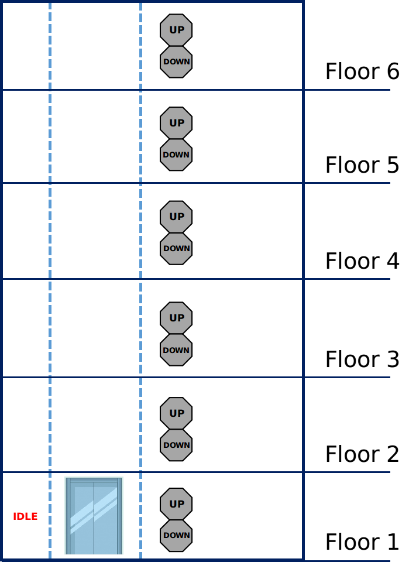
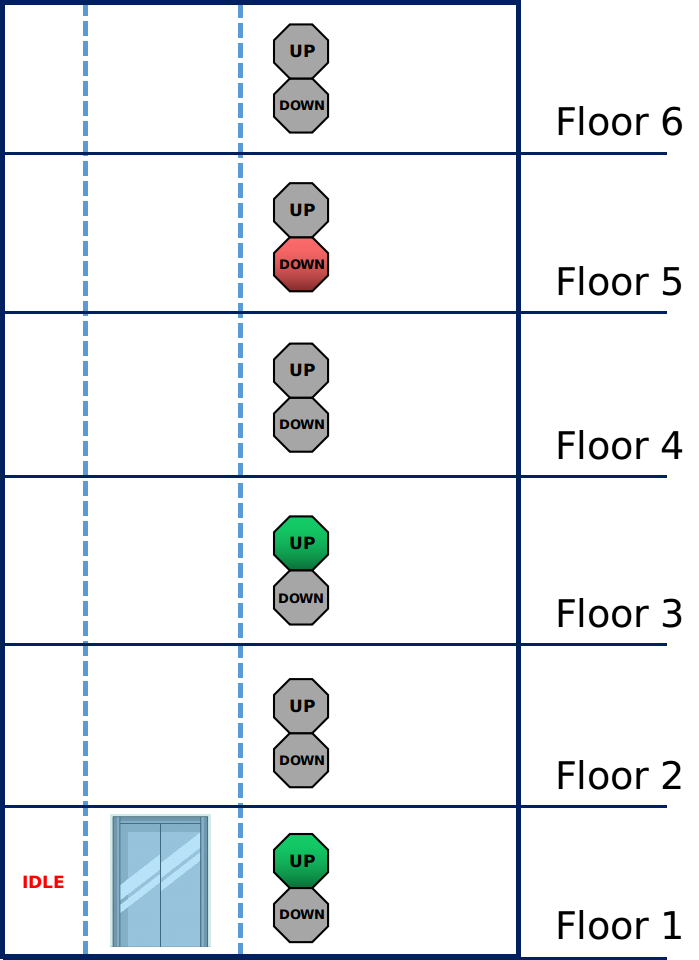
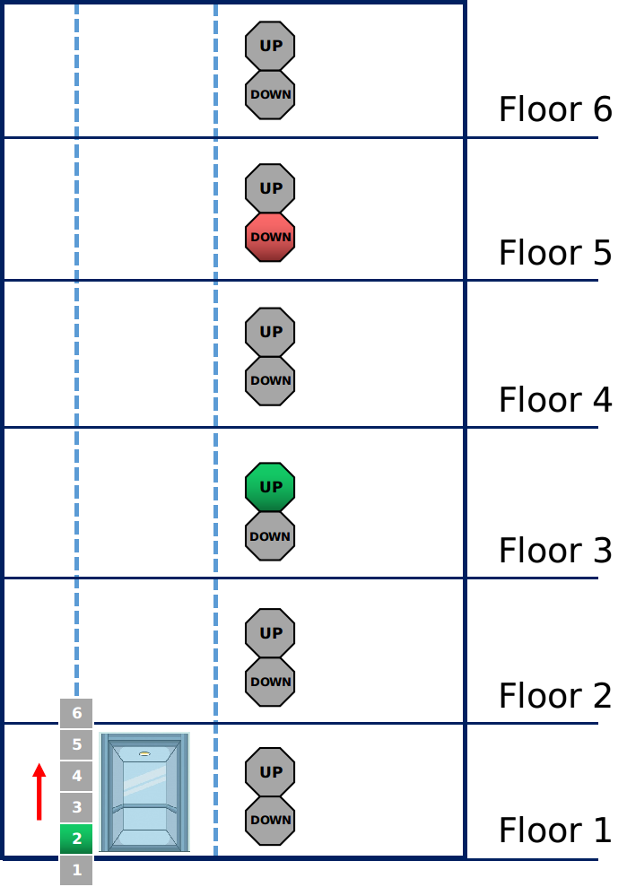
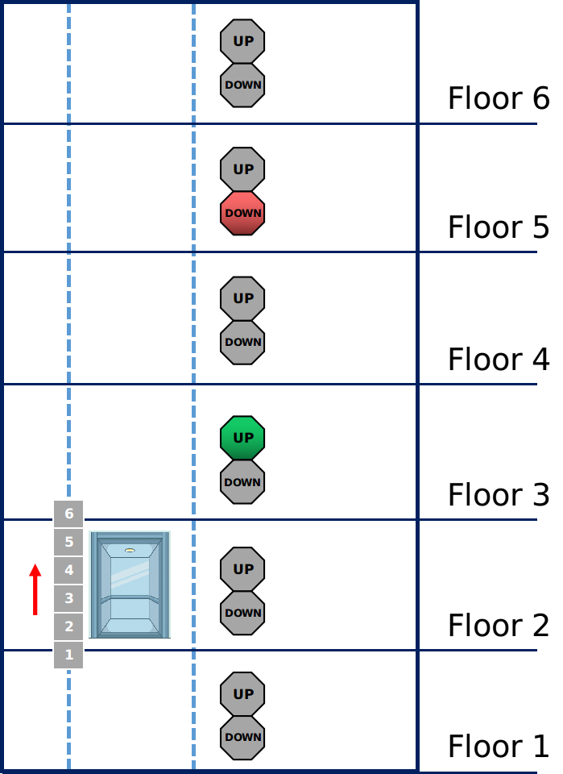
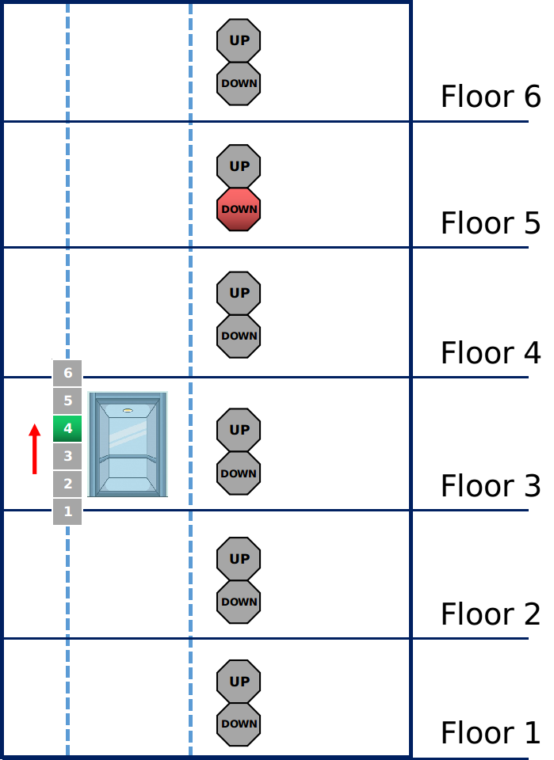
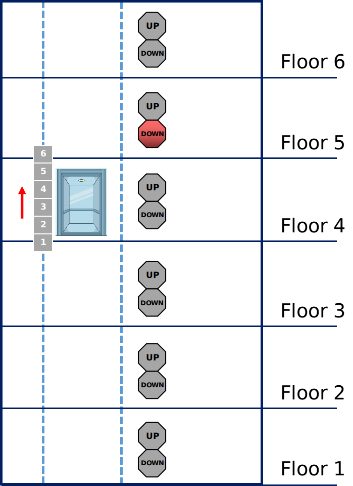
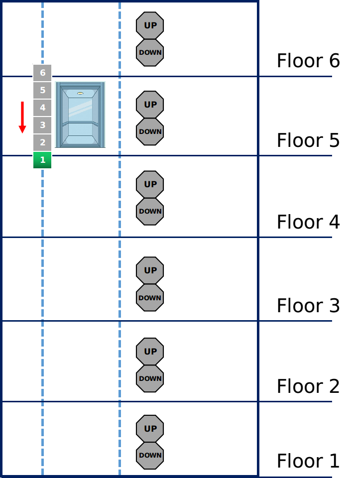
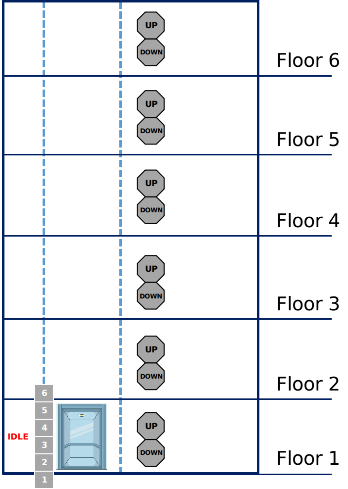

# Elevator Management System

A C++-based elevator management system that simulates elevator operations using Object-Oriented Design (OOD). The system handles external requests from different floors and internal requests made from inside the elevator while managing elevator movement, direction, stops, and state transitions.

## Dependencies for Running Locally

- CMake >= 3.5
- Make >= 4.1 (Linux, Mac), 3.81 (Windows)
- GCC/G++ >= 5.4

## Instructions for Building the Project

1. Clone this repository.
2. Create a build directory in the top-level directory:

```bash
mkdir build && cd build
```

3. Compile the project:

```bash
cmake .. && make
```

## Instructions for Running the Project

### Step 0: Run the Executable

After completing the build process, run:

```bash
./elev_sys_sim
```

### Step 1: Initialize the Elevator System

The terminal will ask:

```text
Please set elevator system with N floors/levels, where N should a positive integer:
```

Enter a positive integer representing the number of floors. For example, enter `6` and press `Enter`.

If the initialization is successful, the terminal will display information about the current state of the elevator system.

At this point, the elevator system should look like this:



### Step 2: Set Up External Requests

Set up external requests by pressing the *Up* or *Down* buttons on different floors.

The terminal will ask:

```text
Please give an input: at how many floors the external elevator button is pushed (from 1 to N)
```

Here, `N` is the number of floors specified in Step 1. For this example, `N` is `6`.

For example, enter `3` and press `Enter` to indicate that external requests have been made from three floors.

The terminal will then ask for the floor number and direction for each request:

```text
Please give an input: at which floor the external elevator button is pushed (from 1 to 6)
Which button you would press, Up or Down (u/d)?
```

For this example, enter the following requests:

- `1` + `u`
- `3` + `u`
- `5` + `d`

If the requests are successfully configured, the terminal will indicate that the external requests have been set up and will begin executing them.

At this point, the elevator system should look like this:



### Step 3: Execute External and Internal Requests

The elevator will execute the external requests and allow users to provide internal requests by selecting destination floors inside the elevator.

In our example, the elevator first executes the external request at floor `1`. The elevator gate opens and the user is asked to provide an internal request.

Enter `2` to travel from floor `1` to floor `2`.

At this point, the elevator system should look like this:



The elevator then executes the internal request by moving to floor `2` and opening the gate. Enter `-1` to indicate that the internal request has been completed and the passenger exits the elevator.

At this point, the elevator system should look like this:



The elevator then executes the next external request by moving to floor `3`. The gate opens and the user is asked to provide an internal request.

Enter `4` to travel from floor `3` to floor `4`.

At this point, the elevator system should look like this:



The elevator then executes the internal request by moving to floor `4` and opening the gate. Enter `-1` to indicate that the internal request has been completed and the passenger exits the elevator.

At this point, the elevator system should look like this:



The elevator then executes the next external request by moving to floor `5`.

This time, the direction of the request changes from **Up** to **Down**. The gate opens and the user is asked to provide an internal request.

Enter `1` to travel from floor `5` to floor `1`.

At this point, the elevator system should look like this:



Finally, the elevator executes the internal request by moving to floor `1` and opening the gate.

Enter `-1` to indicate that the internal request has been completed and the passenger exits the elevator.

Once all external and internal requests have been executed, the elevator changes its status to **IDLE**.

At this point, the elevator system should look like this:



### Step 4: Continuous Simulation

After completing the request sequence, the simulation continues to loop through the elevator workflow.

Users can experiment with different floor configurations and request combinations.

To stop the program, press:

```text
Ctrl + C
```

## Overview of Code Structure

The project follows an Object-Oriented Design (OOD) approach.

The main components include:

- `Elevator` — manages elevator movement, requests, stops, and state.
- `Request` — base class for elevator requests.
- `ExternalRequest` — represents requests made from outside the elevator.
- `InternalRequest` — represents requests made from inside the elevator.
- `elevator_sim.cpp` — contains the simulation logic and user interaction.

The header files are located in the `include/` directory, while the implementation files are located in the `src/` directory.

### Key Methods

#### `void Elevator::handleExternalRequest(ExternalRequest r)`

- Takes an `ExternalRequest` object as input.
- Arranges `up_stops_` or `down_stops_` for the next steps of external request execution.
- Changes the elevator's status from *Up* to *Down* or vice versa when required.

#### `void Elevator::handleInternalRequest(InternalRequest r)`

- Takes an `InternalRequest` object as input.
- Arranges `up_stops_` or `down_stops_` for the next steps of internal request execution.
- Supports requests within the valid range of floors.
- Does not change the elevator's current direction.

#### `void Elevator::openGate()`

- Processes the next `ExternalRequest` or `InternalRequest`.
- Checks `up_stops_`, `down_stops_`, and the current elevator state.
- Updates the stop information after processing a request.

#### `void Elevator::closeGate()`

- Updates the elevator's current status after completing a request.

The project also contains additional helper functions for displaying system information and managing class data through setters and getters.

## Future Improvements

Possible improvements to the system include:

- Support for multiple elevators
- More advanced request scheduling
- Improved request prioritization
- Automated unit testing
- Better handling of simultaneous requests
- Improved input validation and error handling
- Graphical user interface
- Support for concurrent elevator operations
